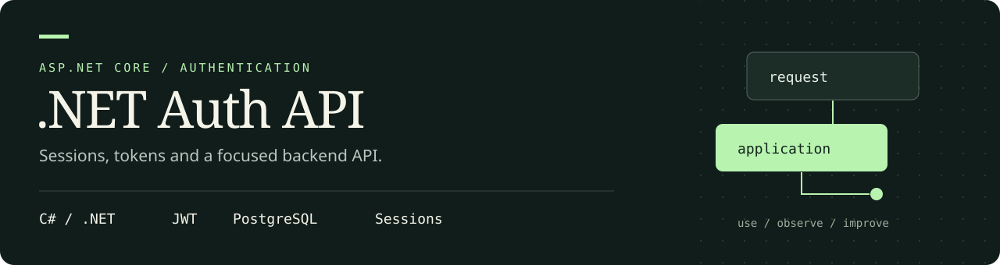

<p align="center"></p>

# .NET Auth API

**Учебный backend-проект на ASP.NET Core: авторизация, пользователи и управление сессиями.**

Проект начинался как основа интернет-магазина. Текущая реализованная API-часть сосредоточена на аутентификации. Полноценные каталог, корзина и оформление заказов пока не заявляются как готовые функции.

## Реализовано

- Регистрация и вход с JWT access token.
- Refresh-токены в HttpOnly cookie и обновление сессии.
- Просмотр и отзыв сессий, выход из текущей и всех сессий.
- Административные операции с пользователями.
- Валидация запросов, обработка ошибок и ограничение частоты запросов.
- Хранение данных через Entity Framework Core и PostgreSQL.
- Тесты сервисов, контроллеров и валидаторов.

## Стек

C# / .NET 9, ASP.NET Core, EF Core, PostgreSQL, FluentValidation, AutoMapper, xUnit, Moq, FluentAssertions, Docker Compose.

## Структура

| Каталог | Ответственность |
|:--|:--|
| `OnlineStore.Api` | HTTP API, middleware и конфигурация приложения |
| `OnlineStore.Application` | Контракты, DTO, валидация и маппинг |
| `OnlineStore.Domain` | Доменные сущности |
| `OnlineStore.Infrastructure` | Хранилище данных, сервисы авторизации и токены |
| `tests/OnlineStore.Auth.Tests` | Проверки авторизации и валидации |
| `tools/OnlineStore.Client` | Демонстрационный консольный клиент |

## Локальный запуск

Требуются .NET 9 SDK и Docker с Compose. Для контейнерного запуска API достаточно Docker.

1. Создайте файл `.env` рядом с `docker-compose.yml`.
2. Укажите `JWT_KEY`: собственный случайный ключ подписи длиной не менее 64 символов. Не публикуйте его.
3. При необходимости задайте `POSTGRES_PASSWORD` для локальной БД.
4. Запустите:

```sh
docker compose up --build
```

Swagger: <http://localhost:5232/swagger>. В compose используется режим Development. Эти настройки предназначены для локальной разработки.

## Проверки

```sh
dotnet restore OnlineStore.sln
dotnet test OnlineStore.sln
```

Консольный клиент:

```sh
dotnet run --project tools/OnlineStore.Client/OnlineStore.Client.csproj
```

Наличие тестов не означает, что текущая версия прошла проверку в любой среде. Результат подтверждается отдельным запуском.

## Документация и границы

[Подробное описание API и устройства проекта](docs/architecture-and-api.md).

Дальнейшие задачи: воспроизводимая CI-проверка, интеграционные сценарии с PostgreSQL, уточнение границ доменной модели. Для полноценного магазина потребуются отдельные пользовательские сценарии каталога, корзины и заказов.
